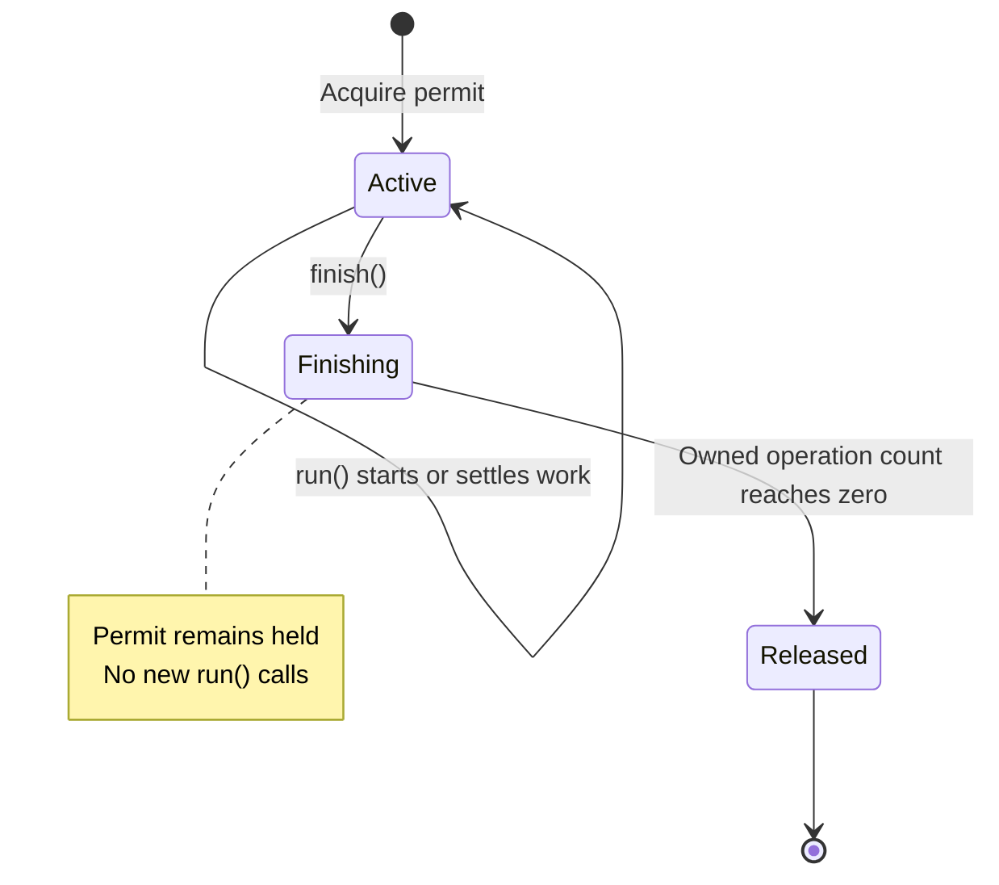

# Architecture

## Domain boundary

The domain operation counts physical MPEG-1 Layer III frames in completed,
unchanging bytes. It currently accepts a file path through `countFrames(path,
signal?)`. The parser owns and closes its descriptor, returns a positive count,
and uses `InvalidMp3Error` only for invalid/unsupported media. I/O errors and
cancellation remain distinguishable. HTTP status and admission do not enter it.

Fastify owns HTTP transport. A scoped upload adapter validates multipart input,
receives a private file, calls the parser and disposes the data. App construction
and process startup remain separate. Mutable state belongs to an instance or
request; there is no account, patient, database or persistent-media model.

| File                      | Responsibility                                                               |
| ------------------------- | ---------------------------------------------------------------------------- |
| `src/app.ts`              | Construct Fastify, app-owned admission/storage probes and the close barrier  |
| `src/config.ts`           | Validate and freeze programmatic/runtime settings without exposing values    |
| `src/logging.ts`          | Serialize allowlisted events through the root logger without private context |
| `src/server.ts`           | Bind the compiled executable and own bounded signal-driven shutdown          |
| `src/healthcheck.ts`      | Probe readiness with an absolute deadline and silent exit status             |
| `src/upload/route.ts`     | Validate transport headers, stream/complete the request, stage/count/dispose |
| `src/upload/error.ts`     | Map known failures and hide unexpected exception details                     |
| `src/upload/admission.ts` | App-local synchronous permits, stopped admission and settled-work barrier    |
| `src/upload/lifetime.ts`  | Request cancellation/deadline and coordination until all owned work settles  |
| `src/mp3/header.ts`       | Pure MPEG header interpretation and indexed/free-format classification       |
| `src/mp3/free-format.ts`  | Ascending candidate search and file-owned framing work limits                |
| `src/mp3/reader.ts`       | Bounded positional file reads and cancellation checks                        |
| `src/mp3/tags.ts`         | Leading/terminal envelope validation and file-owned metadata ambiguity limit |
| `src/mp3/count.ts`        | Descriptor ownership, physical traversal and iterative candidate checkpoints |
| `src/mp3/error.ts`        | Domain-specific invalid-media error                                          |

Read app, upload route, then count to follow a successful request. There is no DI
container, controller/service/repository layer stack, barrel hierarchy or generic
utilities directory. Biome enforces parser independence; a test exercises the real
rule with both permitted and forbidden code.

## Temporary staging decision

The upload is streamed to a private directory using an exclusive fixed filename;
the client filename is never a path. Parsing uses one 64 KiB cache. This yields a
completed-file view for EOF checks, terminal metadata and free-format replay.
It costs a write/read pass and explicit disposal. Numeric checkpoints retain
candidate state without holding a scan buffer per alternative.

For ordinary indexed frames, inline counting could overlap upload with parsing
and avoid whole-file staging. That alternative would need explicit chunk-boundary,
EOF, metadata, cancellation and compatibility rules. Staging is the selected
implementation for this release, not a general requirement of MP3 counting or a
constitutional principle. A substantial change to this boundary deserves a new
specification with behavior and resource evidence.

Request-local temporary files do not create session affinity or durable application
state. Replicas are independent; local data cannot be relied on after process loss.
Storage retention, transcription, transcoding, identity and durable jobs would
introduce different ownership and belong to separately specified capabilities.

## Tool choices

Fastify supplies HTTP lifecycle, logging integration and multipart support
without requiring extra application layers. This service uses its transport and
encapsulation features directly. A second framework or DI container would add
indirection without a present domain need. Vitest covers unit and real integration
tests; Biome provides one formatter/linter and the dependency boundary. Playwright
informs repository guidance; this API has no browser workflow requiring its runner.

**Node 24.22.3** pins the maintained 24.x LTS line and the security release available
at this revision, with the matching official slim image. Node 26.13.1 is the newer
Active LTS release; 24 is in Maintenance LTS, not the newest LTS. Keeping the tested
24.x baseline is a conservative compatibility choice, not evidence of a known
26.x incompatibility. See the [release](https://nodejs.org/en/blog/release/v24.22.3)
and [support schedule](https://github.com/nodejs/Release#release-schedule).
The `engines` range permits later compatible 24.x patches; `.nvmrc`, CI and the
image select the exact evaluated baseline. Treat a runtime upgrade as a reviewed
change with the process/container gates.

**TypeScript 7.0.2** is the stable compiler release selected for this build; see
[upstream releases](https://github.com/microsoft/TypeScript/releases).
Strict NodeNext/ESM settings, checked indexed access, exact optional properties
and erasable syntax make types and runtime module resolution agree. The compiler
checks code that Node's native development type stripping does not check.
Production runs compiled JavaScript; dev/test utilities can execute TypeScript
with the pinned runtime. A newer compiler does not require selecting the newest
Node major independently of its compatibility/support evidence.

The harness uses concise module/command guidance inspired by
[Playwright](https://github.com/microsoft/playwright/blob/main/AGENTS.md), the
[Clean Code TypeScript](https://github.com/labs42io/clean-code-typescript) principles
of descriptive names and cohesive responsibilities, and Thoughtworks' warning
about [agent instruction bloat](https://www.thoughtworks.com/en-us/radar/techniques/agent-instruction-bloat).
Load focused context and prefer a regression or deterministic check over another
permanent instruction. The Lean workflow is recorded in [the delivery map](../specs/README.md).

## Upload resource ownership

Each `createApp` constructs one `UploadAdmission`; requests acquire synchronously
before asynchronous work. A permit is idempotent and cannot release a different
request's slot. This is safe within one Node event loop without a global counter
or distributed lock. Each replica/worker has its own budget; fleet and tenant
limits remain ingress responsibilities.

A request lifetime owns its AbortController, deadline and transport listeners.
It tracks unsettled work, not only HTTP responses. Normal HTTP-body closure does
not cancel counting. Deadline or disconnect signals cancellation, but reception,
counting, rejected-body consumption and disposal must settle before capacity
returns. The only test seams replace count/dispose operations to control those
observable boundaries.

The lifetime in `src/upload/lifetime.ts` has three logical states:

`run()` counts an operation until its callback's promise settles, including file
disposal in that callback's `finally`. `finish()` prevents new work and releases the permit only
when the operation count is zero; it does not itself cancel pending work. With
no pending work, finishing releases immediately. Repeated finishing/release
notifications are harmless.

The route calls `finish()` after successful disposal; the error handler's
`finally` and the `onResponse` hook also request it. A deadline or premature
request/response disconnect both abort the signal and request finishing. The
deadline attempts a safe 503 when a reply remains possible. Ordinary request-body
closure after HTTP completion does neither, so counting can continue. A completed
response alone cannot release a permit while owned work is still pending.

Default policy is four admitted uploads, a 100 MiB file limit and a 30-second
deadline. Rejected input has a 64 KiB drain allowance plus at most one delivered
chunk, bounded by the same deadline. Nonadmitted busy/draining requests receive
a safe 503 with `Retry-After: 1` and a closing connection; they do not wait for a
body, create a file or queue for capacity. Fastify's independent closing response
is disabled so the application policy retains its JSON shape and retry header.

`app.close()` stops admission and waits for actual settled uploads and any
in-flight readiness storage probe, including after its client disconnects.
The probe promise is captured before waiting for uploads so its reset cannot
hide unfinished work. The deadline cannot preempt blocked JavaScript or an
uninterruptible filesystem operation. The executable adds a referenced grace
timer, closes active sockets after grace, and exits unsuccessfully if work still
has not settled one second later. See [operations](operations.md) for details.

Disposal runs even after cancellation. A failed removal can leave data despite
released capacity; the service returns a generic 500 when still possible and
does not claim deletion succeeded. Abrupt process loss can also leave files.
Use disposable, bounded per-replica storage; the application has no startup
scavenger or background removal retry.

The service bounds file bytes and application work. Total HTTP headers/body,
connection counts, partial HTTP headers, TLS/authentication and fleet/tenant
quotas need a trusted ingress. Multipart preamble and epilogue are not file-part
bytes. The application deadline begins only after complete HTTP request headers.

## Process and logging boundary

The factory returns an app and its admission owner without starting a listener.
Only the executable binds a socket, reads environment variables and registers
signals. The healthcheck is a separate small executable. Configuration is frozen
and passed explicitly; immutable constants are not mutable application globals.

Request IDs are generated internally and returned in `x-request-id`. The logger
reconstructs typed events and fixed route labels instead of serializing requests,
exceptions or arbitrary messages. The root logger owns output context because
child bindings can otherwise bypass a parent binding formatter. Tests exercise
actual nested-child output, not only a redaction helper.

Readiness probes real storage without caching completed results. A shared
in-flight promise prevents concurrent probe duplication and belongs to the app's
close barrier. Readiness indicates whether the replica can accept work; momentary
capacity exhaustion is a per-request 503 rather than a reason to remove a healthy
replica from service.

## Future changes

| Change                                          | Domain decision and first evidence                                                                                                                                                                 |
| ----------------------------------------------- | -------------------------------------------------------------------------------------------------------------------------------------------------------------------------------------------------- |
| Add a checksum or framing summary               | Keep only if it is byte-level inspection; specify an explicit compatible/new response contract and independent fixture expectations before changing the current exact JSON shape                   |
| Support another MPEG version/layer              | A deliberate extension of the framing domain; new tables/formulas, real independently counted fixtures and invalid/unsupported boundary tests                                                      |
| Count while receiving                           | Revisit the staging plan in a new cycle; prove chunk-boundary, EOF/tag/free-format behavior, cancellation and memory/work limits while preserving existing compatibility or explicitly changing it |
| Improve admission, cleanup or logging           | Keep in this service's operational boundary; retain real lifecycle/privacy regressions and measure the resource effect                                                                             |
| Store uploads, resume jobs or deliver webhooks  | Introduces durable ingestion/job ownership; usually a separate orchestrator/object-storage capability with a defined contract to this stateless inspection service                                 |
| Transcode, transcribe or infer clinical meaning | Different compute, privacy, domain and dependency concerns; use a separate capability/service unless an explicit scope decision and evidence justify expansion                                     |
| Add tenant authentication or fleet quotas       | Integrate the trusted ingress/platform boundary; do not treat a per-process counter as a distributed policy                                                                                        |

Start with a cohesive module when a change still belongs to this domain. A table
entry is not a requirement to create microservices: separate services make sense
when ownership, security, scaling or lifecycle differs materially. Durable
orchestration should not be hidden behind another upload-route option. Keep an
ADR-sized decision in the owning feature's plan rather than introducing a second
parallel specification system.
