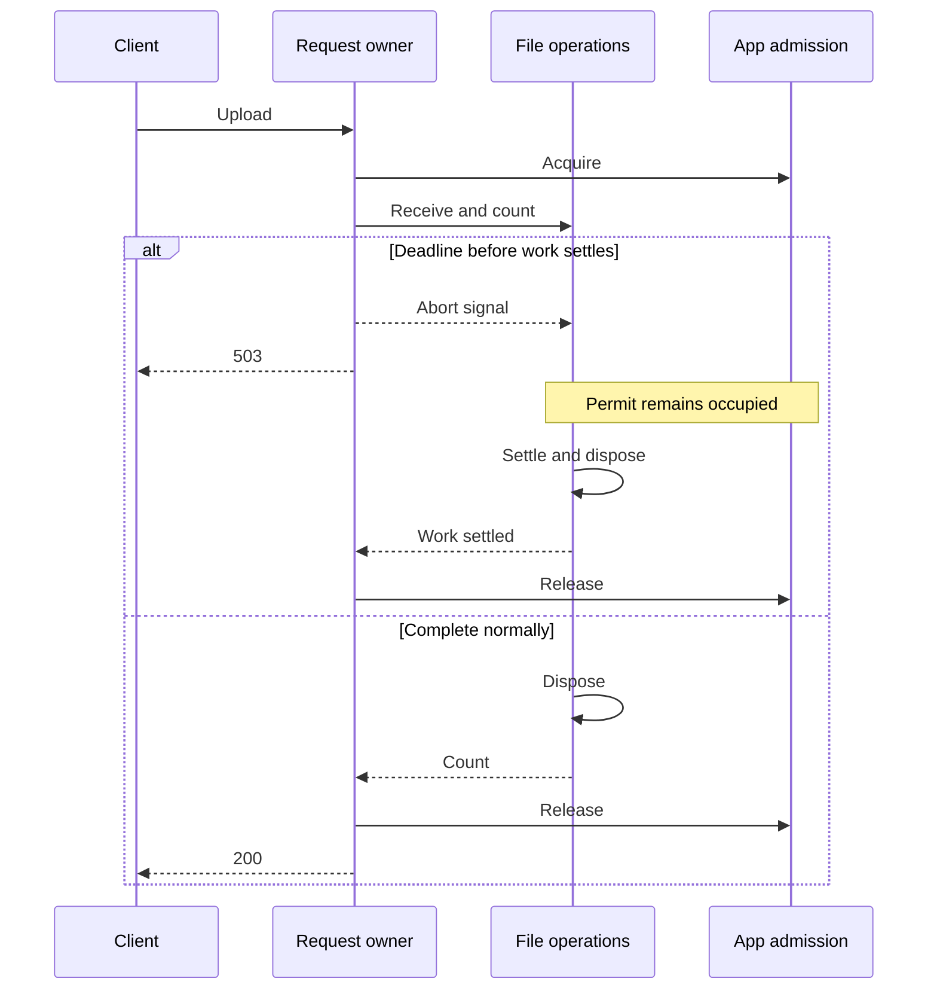

# Architecture

## Domain boundary

The domain operation counts physical MPEG-1 Layer III frames in completed,
unchanging bytes. It currently accepts a file path through `countFrames(path,
signal?)`. The parser owns and closes its descriptor, returns a positive count,
and uses `InvalidMp3Error` only for invalid/unsupported media. I/O errors and
cancellation remain distinguishable. HTTP status and admission do not enter it.

Fastify owns HTTP transport. A scoped upload adapter validates multipart input,
receives a private file, calls the parser and disposes the data. App construction
and process startup remain separate. Mutable state belongs to an instance or
request; there is no account, patient, database or persistent-media model.

| File                      | Responsibility                                                               |
| ------------------------- | ---------------------------------------------------------------------------- |
| `src/app.ts`              | Construct one Fastify instance, its admission budget and close barrier       |
| `src/server.ts`           | Start the compiled executable                                                |
| `src/upload/route.ts`     | Validate transport headers, stream/complete the request, stage/count/dispose |
| `src/upload/error.ts`     | Map known failures and hide unexpected exception details                     |
| `src/upload/admission.ts` | App-local synchronous permits, stopped admission and settled-work barrier    |
| `src/upload/lifetime.ts`  | Request cancellation/deadline and coordination until all owned work settles  |
| `src/mp3/header.ts`       | Pure MPEG header interpretation and indexed/free-format classification       |
| `src/mp3/free-format.ts`  | Ascending candidate search and file-owned framing work limits                |
| `src/mp3/reader.ts`       | Bounded positional file reads and cancellation checks                        |
| `src/mp3/tags.ts`         | Leading/terminal envelope validation and file-owned metadata ambiguity limit |
| `src/mp3/count.ts`        | Descriptor ownership, physical traversal and iterative candidate checkpoints |
| `src/mp3/error.ts`        | Domain-specific invalid-media error                                          |

Read app, upload route, then count to follow a successful request. There is no DI
container, controller/service/repository layer stack, barrel hierarchy or generic
utilities directory. Biome enforces parser independence; a test exercises the real
rule with both permitted and forbidden code.

## Temporary staging decision

The upload is streamed to a private directory using an exclusive fixed filename;
the client filename is never a path. Parsing uses one 64 KiB cache. This yields a
completed-file view for EOF checks, terminal metadata and free-format replay.
It costs a write/read pass and explicit disposal. Numeric checkpoints retain
candidate state without holding a scan buffer per alternative.

For ordinary indexed frames, inline counting could overlap upload with parsing
and avoid whole-file staging. That alternative would need explicit chunk-boundary,
EOF, metadata, cancellation and compatibility rules. Staging is the selected
implementation for this release, not a general requirement of MP3 counting or a
constitutional principle. A substantial change to this boundary deserves a new
specification with behavior and resource evidence.

Request-local temporary files do not create session affinity or durable application
state. Replicas are independent; local data cannot be relied on after process loss.
Storage retention, transcription, transcoding, identity and durable jobs would
introduce different ownership and belong to separately specified capabilities.

## Tool choices

Fastify supplies maintained HTTP/multipart lifecycle handling without imposing
extra application layers. TypeScript 7.0.2 is pinned with strict NodeNext settings;
Node 24.22.3 is a maintained LTS patch whose official slim image is available. The
compiler checks code that native development type stripping does not check.
Production executes compiled JavaScript. Vitest covers unit and real integration
tests; Biome provides one formatter/linter and the dependency boundary.

The harness uses concise module/command guidance inspired by
[Playwright](https://github.com/microsoft/playwright/blob/main/AGENTS.md), the
[Clean Code TypeScript](https://github.com/labs42io/clean-code-typescript) principles
of descriptive names and cohesive responsibilities, and Thoughtworks' warning
about [agent instruction bloat](https://www.thoughtworks.com/en-us/radar/techniques/agent-instruction-bloat).
Load focused context and prefer a regression or deterministic check over another
permanent instruction. The Lean workflow is recorded in [the delivery map](../specs/README.md).

## Upload resource ownership

Each `createApp` constructs one `UploadAdmission`; requests acquire synchronously
before asynchronous work. A permit is idempotent and cannot release a different
request's slot. This is safe within one Node event loop without a global counter
or distributed lock. Each replica/worker has its own budget; fleet and tenant
limits remain ingress responsibilities.

A request lifetime owns its AbortController, deadline and transport listeners.
It tracks unsettled work, not only HTTP responses. Normal HTTP-body closure does
not cancel counting. Deadline or disconnect signals cancellation, but reception,
counting, rejected-body consumption and disposal must settle before capacity
returns. The only test seams replace count/dispose operations to control those
observable boundaries.

Default policy is four admitted uploads, a 100 MiB file limit and a 30-second
deadline. Rejected input has a 64 KiB drain allowance plus at most one delivered
chunk, bounded by the same deadline. Nonadmitted busy/draining requests receive
a safe 503 with `Retry-After: 1` and a closing connection; they do not wait for a
body, create a file or queue for capacity. Fastify's independent closing response
is disabled so the application policy retains its JSON shape and retry header.

`app.close()` stops admission and waits for actual settled work. The deadline
cannot preempt blocked JavaScript or an uninterruptible filesystem operation.
Process-level bounded shutdown belongs to the next operational cycle.

Disposal runs even after cancellation. A failed removal can leave data despite
released capacity; the service returns a generic 500 when still possible and
does not claim deletion succeeded. Abrupt process loss can also leave files.
Use disposable, bounded per-replica storage; the application has no startup
scavenger or background removal retry.

The service bounds file bytes and application work. Total HTTP headers/body,
connection counts, partial HTTP headers, TLS/authentication and fleet/tenant
quotas need a trusted ingress. Multipart preamble and epilogue are not file-part
bytes. The application deadline begins only after complete HTTP request headers.
