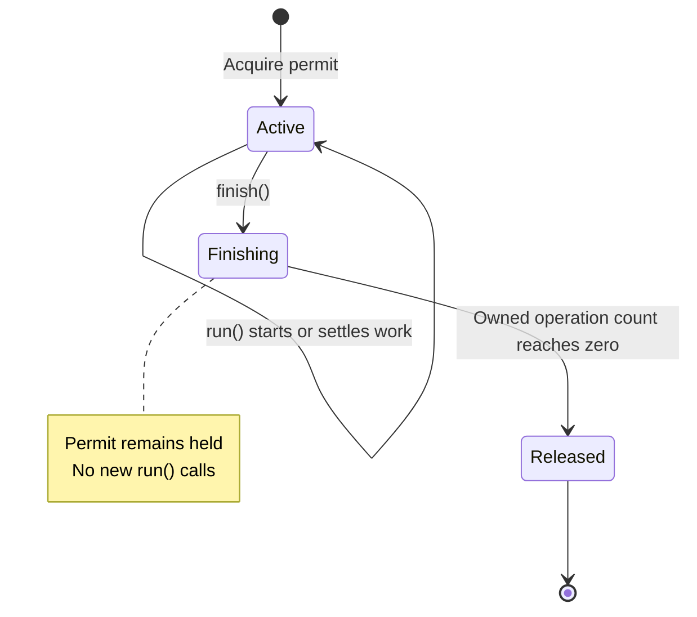

# Architecture

## Domain and transport boundary

`countFrames(input: AsyncIterable<Uint8Array>, signal?)` counts physical MPEG-1
Layer III frames as bytes arrive. It owns the input iterator, returns a positive
count only after valid EOF, and closes the iterator on completion or failure.
`InvalidMp3Error` distinguishes invalid/unsupported media from upstream errors
and cancellation. The parser imports no HTTP, configuration or filesystem code.

Fastify owns multipart and HTTP framing. The upload adapter passes the file
stream directly to the counter, then validates all remaining multipart and HTTP
input before publishing the count. A provisional count never permits early
success. App construction and process startup remain separate; mutable state
belongs to an application or request.

The service continues to start through `src/server.ts` (`dist/server.js` after
compilation), using the existing app factory and upload route. That route passes
`part.file` directly to the counter. The resource check launches this same
entrypoint; its optional memory-monitor preload does not construct an app or
open a network listener.

| File                      | Responsibility                                                               |
| ------------------------- | ---------------------------------------------------------------------------- |
| `src/app.ts`              | Construct Fastify, application admission, health routes and close barrier    |
| `src/config.ts`           | Validate and freeze programmatic/runtime settings                            |
| `src/logging.ts`          | Serialize allowlisted events through the root logger                         |
| `src/server.ts`           | Bind the executable and own bounded signal-driven shutdown                   |
| `src/healthcheck.ts`      | Probe readiness with an absolute deadline and silent exit status             |
| `src/upload/route.ts`     | Validate transport, stream/count the file and await complete input           |
| `src/upload/error.ts`     | Classify safe errors and bound rejected-body consumption                     |
| `src/upload/admission.ts` | Application-local permits, stopped admission and drain barrier               |
| `src/upload/lifetime.ts`  | Cancellation/deadline and coordination until owned work settles              |
| `src/mp3/header.ts`       | Pure MPEG header interpretation                                              |
| `src/mp3/reader.ts`       | Forward byte-stream cursor, small split descriptors and cooperative yielding |
| `src/mp3/free-format.ts`  | Bounded local free-format inference                                          |
| `src/mp3/tags.ts`         | Incremental envelopes and bounded unknown terminal suffix validation         |
| `src/mp3/count.ts`        | Frame traversal and physical counting                                        |
| `src/mp3/error.ts`        | Domain invalid-media error                                                   |

Read app, upload route, then count to follow a request. Biome enforces parser
independence; harness tests exercise the actual permitted/forbidden imports.
There is no DI container or generic streaming framework.

## Incremental counting and retained state

For CBR and ordinary VBR, each header supplies its own frame length. The parser
assembles a split header, validates it, consumes the remaining payload in bulk,
and increments only when the complete frame has arrived. Payload bytes are not
searched for sync or tag signatures. VBR changes indexed bitrate between frames
and needs no seeking.

The stream cursor borrows only the current producer chunk. Split descriptors
own their small fragments; metadata descriptors retained across source pulls are
copied. The parser retains no frame/chunk history. It yields to the event loop
at least every 64 KiB consumed/searched and checks cancellation during work.
The producer's current chunk and transport buffers are additional input memory;
the parser's bound is not a claim about total process RSS.

A new free-format run commits the first compatible boundary within a 128 KiB
unpadded distance. A stream has at most 4096 inference runs and 16 MiB of charged
inference positions. There is one inferred length/rate, no rollback stack or
completed-file-size budget. A later contradiction rejects the stream. Declared
metadata bodies are skipped by length; unknown footer-only terminal bytes have a
64 KiB buffer and at most 4096 alternative-chain selections. See the
[MP3 guide](mp3.md) and [005 compatibility matrix](../specs/005-incremental-mp3-parsing/spec.md#compatibility-matrix).

Feature 005 removes temporary upload files, directory creation/removal, seek
infrastructure, disposal seams, filesystem readiness probes, `UPLOAD_TEMP_DIR`
and upload tmpfs mounts. Earlier staging choices and verification remain in the
historical feature records; current processing has no upload storage dependency.

## Upload resource ownership

Each app owns one `UploadAdmission`. Acquisition is synchronous, permits release
idempotently, and replicas need no shared filesystem or session affinity. Each
replica/worker has its own concurrency budget; fleet/tenant policy belongs to ingress.

A request lifetime owns its AbortController, deadline and transport listeners:

`run()` counts an operation until its callback settles. `finish()` prevents new
work and releases only when all owned file-stream, parser and rejected-body work
has settled. A timeout response or abort signal alone does not release capacity.
The route's parser/stream cleanup is awaited even after cancellation; a count
operation deliberately ignoring cancellation still occupies its slot.

The default policy is four uploads, 100 MiB file-part bytes and a 30-second
admission-to-processing deadline. Busy/draining requests receive safe 503 JSON,
`Retry-After: 1` and a closing connection without queuing. Rejected input has a
64 KiB drain allowance plus at most one delivered chunk and the same deadline.
Normal completed request-body closure does not cancel parsing. An unfinished
HTTP epilogue may follow provisional counting but prevents success and remains
subject to the deadline.

`app.close()` stops admission and awaits owned work. The executable closes active
connections after shutdown grace, then exits unsuccessfully after one further
second if work remains unsettled. Cancellation is cooperative; it cannot preempt
blocked JavaScript or an uninterruptible external operation.

## Runtime and deployment

Configuration is frozen and passed explicitly. Only process entrypoints read
environment values or register signals. Readiness reflects accepting work;
temporary upload saturation leaves the replica ready. Liveness reflects a
responding process. No filesystem or replacement dependency is probed.

Generated request IDs and fixed route/event/category values support diagnosis.
The logger reconstructs safe events through the root logger so arbitrary objects,
exception text and child bindings cannot introduce private context.

Keep Node 24.22.3, TypeScript 7.0.2, Fastify/multipart, Vitest and Biome at the
pinned versions for this feature. Strict NodeNext/ESM checking remains distinct
from native development type stripping; production executes compiled JavaScript.
The Linux image and launch commands retain non-root execution, a read-only root
and explicit resource/security limits, with no writable upload mount.

Separate heavy [resource checks](testing.md#large-input-resource-checks) use lazy
inputs larger than their server/container budget. Actual measurements and
unavailable environments belong in [005 verification](../specs/005-incremental-mp3-parsing/verification.md).

## Future changes

Add another MPEG version, digest response or different ambiguity policy only
with an explicit compatible/new contract and independent fixture expectations.
Profile realistic traffic before changing batching, concurrency or worker layout.
Durable uploads, jobs, transcription or tenant/fleet quotas introduce different
ownership and require a deliberate domain decision; they are not hidden route
options. Start with a cohesive module when a change still belongs to this service.
