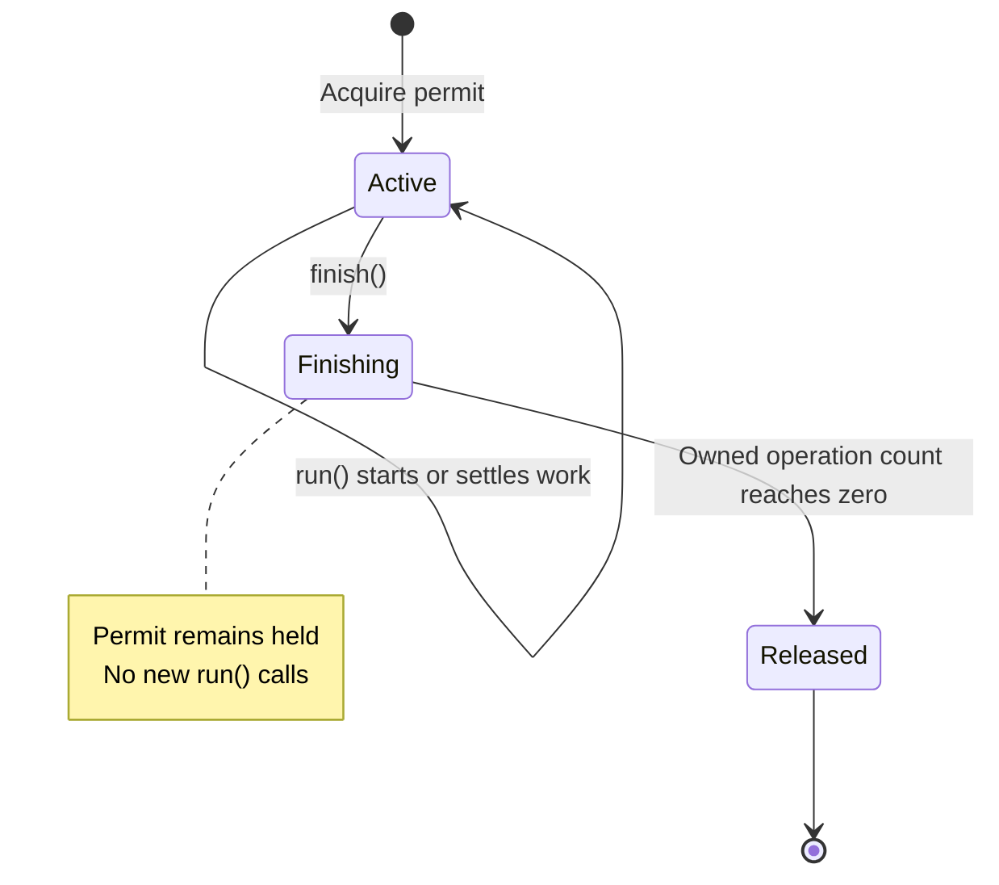

# Architecture

## Domain and transport boundary

`countFrames(input: AsyncIterable<Uint8Array>, signal?)` counts physical MPEG-1
Layer III frames as bytes arrive. It owns the input iterator, returns a positive
count only after identifiable framing through EOF, and closes the iterator on
completion or failure. Metadata fields unrelated to locating frames are ignored.
`InvalidMp3Error` distinguishes invalid/unsupported media from upstream errors
and cancellation. The parser imports no HTTP, configuration or filesystem code.

Fastify owns multipart and HTTP framing. The upload adapter passes the file
stream directly to the counter, then validates all remaining multipart and HTTP
input before publishing the count. A provisional count never permits early
success. App construction and process startup remain separate; mutable state
belongs to an application or request.

The entrypoint is `src/server.ts` (`dist/server.js` after compilation). It creates
the app and starts the listener. The upload route passes `part.file` directly to
the counter. Resource tests launch the compiled entrypoint with a preload that
only measures memory.

| File                      | Responsibility                                                               |
| ------------------------- | ---------------------------------------------------------------------------- |
| `src/app.ts`              | Construct Fastify, application admission, health routes and close barrier    |
| `src/config.ts`           | Validate and freeze programmatic/runtime settings                            |
| `src/server.ts`           | Bind the executable and own bounded signal-driven shutdown                   |
| `src/healthcheck.ts`      | Probe readiness with an absolute deadline and silent exit status             |
| `src/upload/route.ts`     | Validate transport, stream/count the file and await complete input           |
| `src/upload/error.ts`     | Classify safe errors and bound rejected-body consumption                     |
| `src/upload/admission.ts` | Application-local permits, stopped admission and drain barrier               |
| `src/upload/lifetime.ts`  | Cancellation/deadline and coordination until owned work settles              |
| `src/mp3/header.ts`       | Pure MPEG header interpretation                                              |
| `src/mp3/reader.ts`       | Forward byte-stream cursor, small split descriptors and cooperative yielding |
| `src/mp3/free-format.ts`  | Bounded local free-format inference                                          |
| `src/mp3/tags.ts`         | Incremental metadata skipping and bounded terminal boundary discovery        |
| `src/mp3/count.ts`        | Frame traversal and physical counting                                        |
| `src/mp3/error.ts`        | Domain invalid-media error                                                   |

To follow a request, read `app.ts`, `upload/route.ts`, then `mp3/count.ts`.
Biome's import restrictions and their tests enforce parser independence.

For a first tour of the parser, read the [MP3 guide](mp3.md), then `count.ts`
and `header.ts`. The counter has three phases: leading metadata, audio and
trailing metadata. Audio may follow leading metadata, but cannot resume after
trailing metadata begins. The free-format helper returns an already-read next
header; the counter reuses it rather than consuming those bytes twice.
`tags.ts` owns metadata traversal and boundary checks, and `reader.ts` explains the
shared stream position, buffer ownership and cooperative scheduling contracts.

## Incremental counting and retained state

For CBR and ordinary VBR, each header supplies its own frame length. The parser
assembles a split header, validates it, consumes the remaining payload in bulk,
and increments only when the complete frame has arrived. Payload bytes are not
searched for sync or tag signatures. VBR changes indexed bitrate between frames
and needs no seeking.

The stream cursor borrows only the current producer chunk. Split descriptors
own their small fragments; metadata descriptors retained across source pulls are
copied. The parser retains no frame/chunk history. It yields to the event loop
at least every 64 KiB consumed/searched and checks cancellation during work.
The producer's current chunk and transport buffers are additional input memory;
the parser's bound is not a claim about total process RSS.

A new free-format run commits the first compatible boundary within a 128 KiB
unpadded distance. A stream has at most 4096 inference runs and 16 MiB of charged
inference positions. The parser keeps one inferred length/rate for each run;
a later contradiction rejects the stream. Declared
metadata bodies are skipped by length; unknown footer-only terminal bytes have a
64 KiB buffer and at most 4096 alternative-chain selections. See the
[MP3 guide](mp3.md) for boundary rules and examples.

## Upload resource ownership

Each app owns one `UploadAdmission`. Acquisition is synchronous, permits release
idempotently, and replicas need no shared filesystem or session affinity. Each
replica/worker has its own concurrency budget; fleet/tenant policy belongs to ingress.

A request lifetime owns its AbortController, deadline and transport listeners:

`run()` counts an operation until its callback settles. `finish()` prevents new
work and releases only when all owned file-stream, parser and rejected-body work
has settled. A timeout response or abort signal alone does not release capacity.
The route's parser/stream cleanup is awaited even after cancellation; a count
operation deliberately ignoring cancellation still occupies its slot.

The default policy is four concurrent uploads and a 30-second
admission-to-processing deadline, with no application file-size cap. Busy/draining
requests receive safe 503 JSON, `Retry-After: 1` and a closing connection without
queuing. Rejected input has a 64 KiB drain allowance plus at most one delivered
chunk and the same deadline.
Normal completed request-body closure does not cancel parsing. An unfinished
HTTP epilogue may follow provisional counting but prevents success and remains
subject to the deadline.

`app.close()` stops admission and awaits owned work. The executable closes active
connections after shutdown grace, then exits unsuccessfully after one further
second if work remains unsettled. Cancellation is cooperative; it cannot preempt
blocked JavaScript or an uninterruptible external operation.

## Runtime and deployment

Configuration uses shared `env-schema` definitions, is frozen and passed
explicitly. It is resolved before creating Fastify so the logger and standalone
healthcheck use the same policy. Only process entrypoints read environment values
or register signals. Readiness reflects accepting work; temporary upload saturation
leaves the replica ready. Liveness reflects a responding process.

Fastify's standard Pino logger handles requests and application events at the
configured log level. Generated request IDs support diagnosis. Application code
can log messages, objects, errors and child context without a content filter.

The runtime dependencies are Fastify, `@fastify/multipart` and `env-schema`.
Versions are pinned in `package.json` and the lockfile; `.nvmrc` pins Node.
Strict NodeNext/ESM compilation checks types, while development mode runs source
through Node's type stripping. Production executes compiled JavaScript.
The Linux image runs as a non-root user; the documented launch adds a read-only
root and resource limits. Uploads require no writable filesystem.

Separate heavy [resource checks](testing.md#large-input-resource-checks) use lazy
inputs larger than their server/container budget. Actual measurements and
their scope are summarized in [verification](verification.md).

## Future changes

Add another MPEG version, digest response or different ambiguity policy only
with an explicit compatible/new contract and independent fixture expectations.
Profile realistic traffic before changing batching, concurrency or worker layout.
Durable uploads, jobs, transcription or tenant/fleet quotas introduce different
ownership and require a deliberate domain decision; they are not hidden route
options. Start with a cohesive module when a change still belongs to this service.
